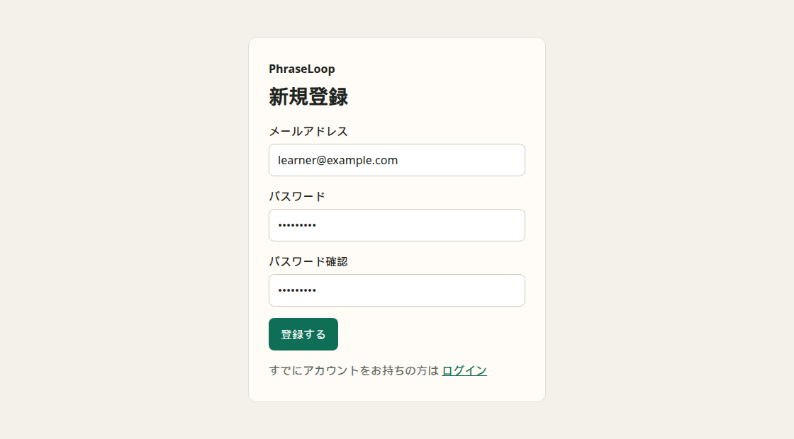
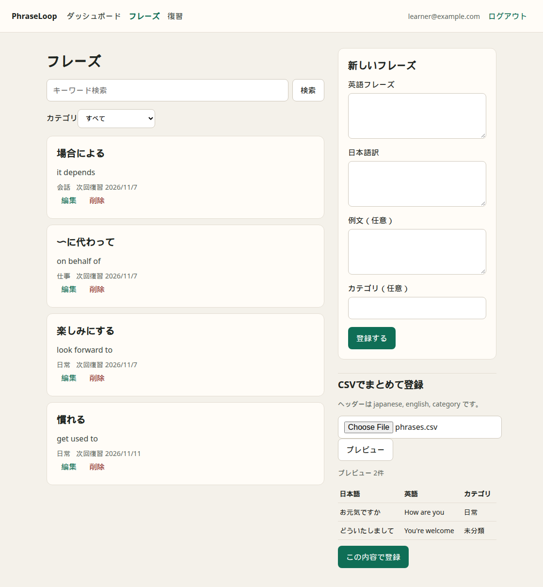
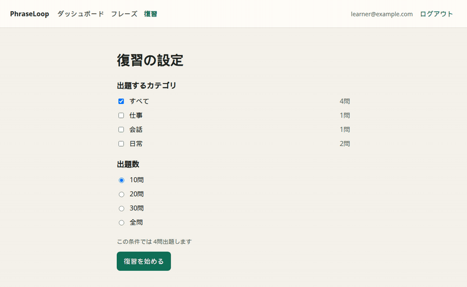
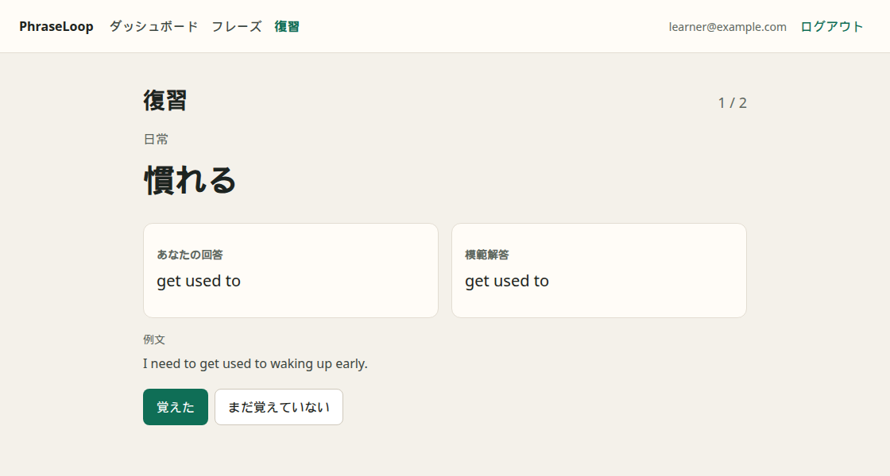
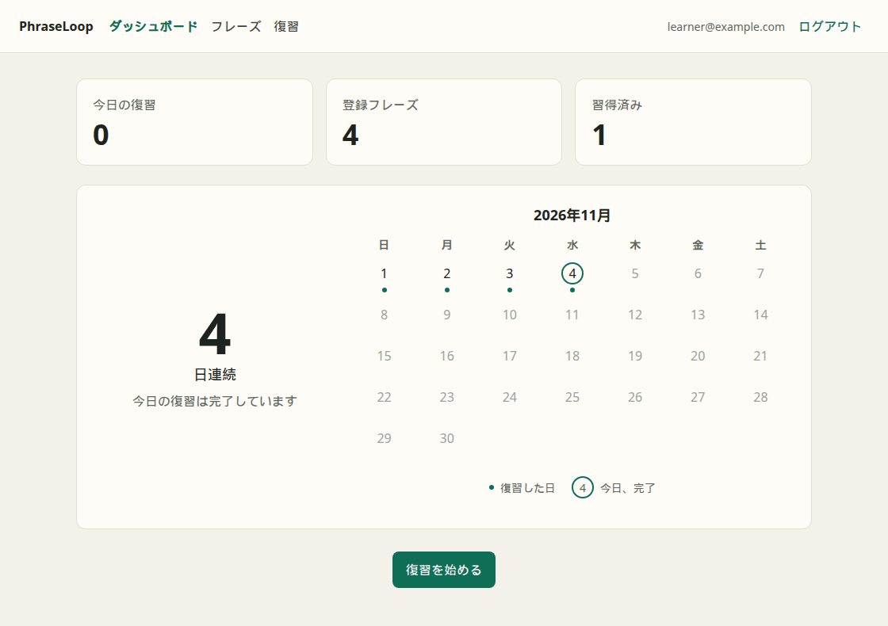
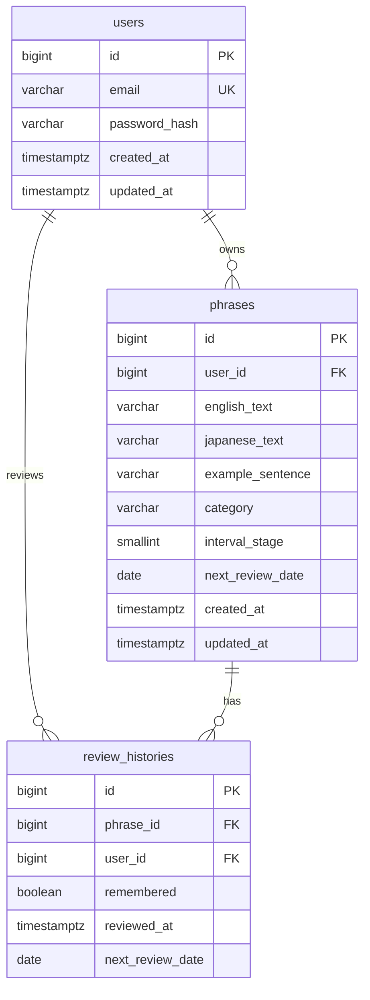

# PhraseLoop
公開サイト：https://phraseloop.onrender.com/login

日本語訳を見て英語フレーズを思い出すための復習アプリです。
登録したフレーズは、覚えたかどうかの自己評価に応じて 1 日後・3 日後・7 日後に再び出題されます。

## 開発背景

単語帳に書いたフレーズは、見返す日を自分で決めないと埋もれます。PhraseLoop は選んだカテゴリから出題し、思い出せたかどうかを本人が判断して次の予定日を決めます。英語表現には別解があるため、入力した英文は自動採点しません。

## 機能

- メールアドレスとパスワードでの新規登録、ログイン、ログアウト
- フレーズの登録、編集、削除、キーワード検索。カテゴリで一覧を絞る。CSV でまとめて登録する
- 日本語を問題にした復習。出題前にカテゴリと出題数を選び、英語を入力し、模範解答を見てから「覚えた」「まだ覚えていない」を選ぶ
- 自己評価に応じた次回復習日の更新と、回答履歴の保存
- ダッシュボードに、今日の件数、登録数、習得済み数、連続日数、当月の復習カレンダー

入力した英文は保存しません。比較は送信前の画面だけで行い、サーバーが受け取るのは自己評価だけです。カテゴリ、CSV、出題数のルールは「要件: カテゴリ別の一覧と復習」に書きます。

メールアドレスとパスワードでアカウントを作ります。



フレーズは英語、日本語訳、例文、カテゴリで登録します。一覧はカテゴリで絞れます。CSV のヘッダーは `japanese`、`english`、`category` で、空のカテゴリはプレビューでは「未分類」と出ます。



復習を始める前に、カテゴリと出題数を選びます。選んだカテゴリの件数が 10 問より少ないときは、その全部を出します。日本語を見て英語を入力し、模範解答を開きます。



自分の回答と模範解答を並べてから、「覚えた」か「まだ覚えていない」を選びます。



連続日数と、その月に復習した日をカレンダーで確認できます。



## 要件: カテゴリ別の一覧と復習

1つのフレーズにカテゴリは1つまでです。カテゴリ用の別テーブルは作りません。名前は前後の空白を除いた完全一致で、100文字までです。手入力で空にしたカテゴリは NULL のまま保存します。NULL、空白、文字列の「未分類」は、一覧と復習では同じ未分類として扱います。CSV でカテゴリが空、または空白だけの行は、文字列の「未分類」として保存します。既存の NULL は「未分類」へ書き換えません。

### フレーズ一覧

フレーズ画面で対象を選びます。初期値は「すべて」です。選択肢は「すべて」、そのユーザーが持っているカテゴリ、未分類のフレーズがあるときの「未分類」です。各選択肢には登録件数を出します。カテゴリ名の並びは文字の昇順で、「未分類」は最後です。

キーワード検索と同時に使えます。両方を指定したときは、両方に一致するフレーズだけを出します。並びは更新が新しい順のままです。他人のカテゴリとフレーズは出しません。

### CSV

ヘッダーは `japanese`、`english`、`category` です。列の順は問わず、これ以外の列は無視します。文字コードは UTF-8 で、先頭の BOM は除きます。プレビューは保存せず、空のカテゴリは「未分類」と表示します。日本語か英語が空の行はエラーにし、その内容では登録できません。登録は全行成功か、1件も保存しないかのどちらかです。例文の列は無く、例文は空のままです。同じ英文が既にあっても登録できます。

### 復習

復習を始める前に、カテゴリと出題数を選びます。カテゴリはチェックボックスです。初期値は「すべて」で、個別のカテゴリとは同時に選べません。個別をすべて外すと「すべて」に戻ります。選択肢は「すべて」、登録済みのカテゴリ、「未分類」です。件数は、次回復習日に関係なく、そのカテゴリの全フレーズです。

出題数は 10問、20問、30問、全問です。初期値は 10問です。選んだカテゴリの件数がそれより少ないときは、その全部を出します。出題順はランダムで、1回の復習に同じフレーズは出ません。該当が0件のときは設定画面に留まり、「この条件のフレーズはありません。」と表示します。進捗は、実際に出る件数に対する番号です。最後の自己評価のあとは「今日の N 問が終わりました。」と表示します。

自己評価は、次回復習日がまだ先のフレーズでも保存できます。間隔の計算は、その回答をした日を起点にします。

### 変えないこと

覚えた場合は3日後、その次は7日後、まだ覚えていない場合は翌日です。段階2で覚えた場合は段階2のまま7日後です。この間隔はカテゴリで変えません。入力した英文は保存しません。

ダッシュボードの今日の件数、登録数、習得済み数、連続日数、当月カレンダーは、カテゴリで分けずアカウント全体のままです。今日の件数は、次回復習日が今日以前のフレーズ数です。カテゴリを限って1問でも復習すれば、その日は復習した日になります。

## 使用技術

- Java 21
- Spring Boot 4.1.2（Spring Security、Spring Data JPA、Validation、Flyway、Actuator）
- PostgreSQL 16
- React 19、TypeScript、Vite 7
- JUnit 5、MockMvc
- Maven、Docker

## システム構成

本番は 1 つの Spring Boot が API とビルド済みの React を同じオリジンで配信します。ホスティングは Render の無料プランで、データベースは Render の無料 PostgreSQL です。

```text
ブラウザ
  └─ Spring Boot（静的ファイル + /api）
       └─ PostgreSQL
```

開発中は Vite が `http://localhost:5173` で画面を出し、`/api` を `http://localhost:8080` へ転送します。セッション Cookie はブラウザから見て Vite のホストに付きます。

認証はサーバーセッションです。Cookie は HttpOnly、SameSite=Lax、本番では Secure です。更新系リクエストは CSRF トークン（`X-XSRF-TOKEN`）が必要です。パスワードは BCrypt でハッシュし、ログには出しません。

## ER図



`interval_stage` は 0（新規）、1（3 日間隔）、2（7 日間隔、習得済み）です。忘れた場合は 0 に戻り、翌日が次の予定日になります。

| 現在 | 覚えた | まだ覚えていない |
| --- | --- | --- |
| 0 | 段階 1、3 日後 | 段階 0、翌日 |
| 1 | 段階 2、7 日後 | 段階 0、翌日 |
| 2 | 段階 2、7 日後 | 段階 0、翌日 |

「今日」は `Asia/Tokyo` の日付です。連続日数は、今日までに 1 問以上復習した日が途切れず続いている日数です。今日がまだでも、昨日まで続いていれば連続は切れません。

## API

認証が必要な API は、セッションのユーザー ID だけで所有者を決めます。他人のフレーズ ID は 404 です。

| API | 成功 | 主な失敗 |
| --- | --- | --- |
| `POST /api/auth/register` | 201 | 400、409 |
| `POST /api/auth/login` | 200 | 400、401 |
| `POST /api/auth/logout` | 204 | 401、403 |
| `GET /api/auth/me` | 200 | 401 |
| `GET /api/auth/csrf` | 204 | |
| `GET /api/phrases?q=&category=` | 200 | 400、401 |
| `GET /api/phrases?uncategorized=true` | 200 | 400、401 |
| `GET /api/phrases/categories` | 200 | 401 |
| `GET /api/phrases/{id}` | 200 | 401、404 |
| `POST /api/phrases` | 201 | 400、401 |
| `POST /api/phrases/import/preview` | 200 | 400、401 |
| `POST /api/phrases/import` | 201 | 400、401 |
| `PUT /api/phrases/{id}` | 200 | 400、401、404 |
| `DELETE /api/phrases/{id}` | 204 | 401、404 |
| `GET /api/reviews/today` | 200 | 401 |
| `POST /api/reviews/session` | 200 | 400、401 |
| `POST /api/reviews/{phraseId}/answer` | 200 | 400、401、404 |
| `GET /api/reviews/history` | 200 | 401 |
| `GET /api/dashboard` | 200 | 401 |
| `GET /actuator/health` | 200 | |

`GET /api/phrases/categories` は、ログイン中のユーザーのカテゴリごとに `name` と `phraseCount` を返します。未分類は `name` を null にします。`category` を付けないときはすべてのフレーズです。`uncategorized=true` のときは未分類だけです。`category` と `uncategorized=true` を同時に指定したときは 400 です。

`POST /api/phrases/import/preview` と `POST /api/phrases/import` は、multipart のフィールド名 `file` で CSV を受け取ります。プレビューは保存しません。行にエラーがある CSV の登録は 400 で、1件も保存しません。

`POST /api/reviews/session` の body は `{ "all": true, "categories": [], "includeUncategorized": false, "questionCount": 10 }` です。`questionCount` を null にすると全問です。選んだカテゴリのフレーズから、重複なくランダムに返します。次回復習日では絞りません。

`POST /api/reviews/{phraseId}/answer` の body は `{ "remembered": true }` だけです。次回復習日が先でも保存できます。履歴は新しい順で最大 50 件です。`GET /api/reviews/today` は、今日以前が期限のフレーズを日付順に返します。画面の出題は `POST /api/reviews/session` を使います。

## 起動方法

PostgreSQL 16 を用意します。

```bash
docker compose up -d
```

Docker を使わない場合は、ユーザー `phraseloop`、パスワード `phraseloop`、データベース `phraseloop` と `phraseloop_test` を作ります。ローカルの初期値は `backend/src/main/resources/application.yml` にあります。本番の接続情報は環境変数で渡し、リポジトリには置きません。

バックエンド:

```bash
cd backend
mvn spring-boot:run
```

API は `http://localhost:8080` です。

フロントエンドの開発サーバー:

```bash
cd frontend
npm ci
npm run dev
```

画面は `http://localhost:5173` です。

本番と同じ形で確認する場合は、フロントをビルドして Spring Boot に同梱します。

```bash
cd frontend && npm ci && npm run build
cp -r dist/* ../backend/src/main/resources/static/
cd ../backend && mvn spring-boot:run
```

ビルド成果物は Git に含めません。

## テスト方法

PostgreSQL の `phraseloop_test` が起動している状態で実行します。接続先は環境変数 `TEST_DATASOURCE_URL`、`TEST_DATASOURCE_USERNAME`、`TEST_DATASOURCE_PASSWORD` で変えられます。

```bash
cd backend
mvn test
```

検証している内容は次のとおりです。

- 新規登録の成功と、パスワードが BCrypt で保存されること
- メールアドレスの重複拒否と、不正入力の拒否
- ログインの成功と失敗。失敗メッセージは登録の有無を区別しない
- 未認証の API が 401 になること
- フレーズの登録、更新、検索、削除
- ユーザー A がユーザー B のフレーズを閲覧、更新、削除、回答できないこと
- 覚えた場合は 3 日後、その次は 7 日後。まだ覚えていない場合は翌日。期限前でも自己評価を保存できること
- 回答履歴が保存されること
- 選んだカテゴリから重複なく出題し、指定数より少なければ全件出ること
- CSV の空欄と空白だけのカテゴリが未分類になり、空の日本語は行エラーになること。エラーのある CSV は保存しないこと
- ダッシュボードの連続日数が、保存された履歴と一致すること
- ヘルスチェックがデータベース接続を含むこと

フロントエンドの自動テストはありません。画面はブラウザで確認します。

## デプロイ

本番は Render の無料プランに公開しています。`render.yaml` の Web Service と PostgreSQL はどちらも `plan: free` です。Web Service はリポジトリの `Dockerfile` からビルドし、画面と API を同じオリジンで配信します。公開アドレスは、Render ダッシュボードの Web Service に表示される `onrender.com` の URL です。

無料プランでは次の制限があります。

- Web Service は 0.1 CPU、512 MB です。15 分間アクセスがないと休止し、次のアクセスで復帰するまで約 1 分かかります。休止中は月 750 時間の無料インスタンス時間を消費しません。
- ログインセッションはメモリ上にあります。休止や再起動でログアウト状態に戻ります。フレーズと復習履歴は PostgreSQL に残ります。
- 無料の PostgreSQL は保存容量 1 GB で、ワークスペースに 1 つまでです。バックアップはありません。作成から 30 日で期限が切れ、その後 14 日の猶予を過ぎるとデータごと削除されます。面接用の短期間公開を想定しています。

環境変数:

| 名前 | 値 |
| --- | --- |
| `SPRING_PROFILES_ACTIVE` | `prod` |
| `SPRING_DATASOURCE_URL` | Render PostgreSQL の JDBC URL。`render.yaml` が設定する |
| `SPRING_DATASOURCE_USERNAME` | Blueprint がデータベースのユーザー名を渡す |
| `SPRING_DATASOURCE_PASSWORD` | Blueprint がデータベースのパスワードを渡す |
| `DATABASE_URL` | `postgres://` 接続文字列。`SPRING_DATASOURCE_URL` が無いとき、起動時に JDBC URL へ変換する |
| `PORT` | Render が割り当てるポート |
| `APP_TIMEZONE` | 未指定時は `Asia/Tokyo` |

ヘルスチェックパスは `/actuator/health` です。本番プロファイルではセッション Cookie を Secure にし、`X-Forwarded-Proto` を信頼します。CORS は開きません。

ローカルで本番イメージを確認する場合:

```bash
docker build -t phraseloop .
docker run --rm -p 8080:8080 \
  -e SPRING_PROFILES_ACTIVE=prod \
  -e SPRING_DATASOURCE_URL=jdbc:postgresql://host:5432/phraseloop \
  -e SPRING_DATASOURCE_USERNAME=phraseloop \
  -e SPRING_DATASOURCE_PASSWORD=secret \
  phraseloop
```

## 工夫した点

- 画面と API を同じオリジンにし、HttpOnly のセッション Cookie と CSRF トークンで認証する
- 復習日の計算をデータベースに依存しないクラスに切り、日付を固定してテストする
- 他人の ID は 403 ではなく 404 とし、存在を推測しにくくする
- 連続日数とカレンダーの日付を `Asia/Tokyo` で揃える
- スキーマ変更は Flyway だけが行い、Hibernate は検証のみ行う

## 今後の改善点

- 入力した英文を、振り返り画面と一緒に保存する
- 自己評価の履歴に応じて間隔を変える
- カレンダーで過去の月を表示する
- フレーズ一覧のページング
- パスワード再設定
